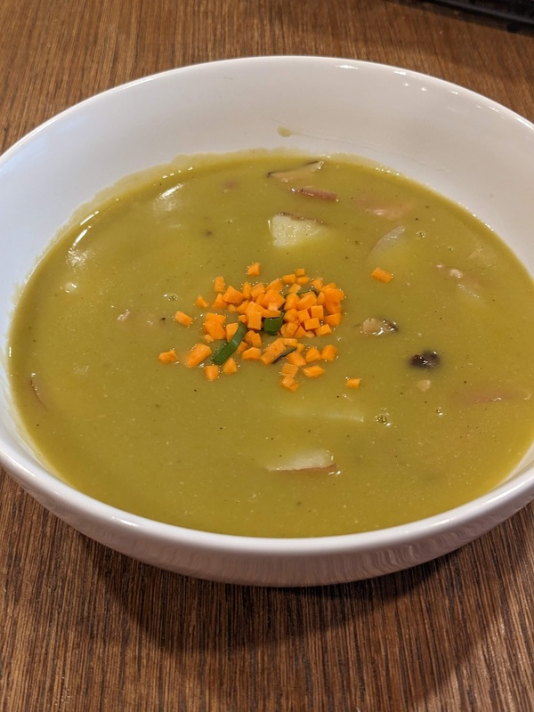

# Alex's Pea Soup

Author: Alex Recker

This is my own take on pea soup.  The base is a classic French _Potage saint Germain_ garnished with cube ham.  Freezing the soup at this stage is practical and delicious, as it will keep the ham for longer.  After thawing, you can add sliced carrots, potatoes, or anything else you desire.

## Materials

**For the Base Soup:**

- split peas, dry (2 lbs)
- white onion, chopped (2 cups)
- carrot, chopped (2 cups)
- leeks, just the green part, chopped (1 cup)
- garlic, peeled & bruised (5-6 cloves)
- butter (ex)
- water or [chicken stock](./white-stock.md), (1 gallon)
- 1 ham bone
- ham, cubed (2 quarts)

## Procedure

### Blanching the Peas

Blanch the peas in batches.

1. Add a peas to a saucepan.  Cover them in at least an inch of cold water.
2. Turn heat to high.  When the water is just about to enter a rolling boil, shut off the heat.
3. Drain the peas into a collander.  Rinse with cold water and set aside.

### Cooking the Soup

1. Add a notch of butter to a large stock pot over medium heat.  When the butter is cracking, add all the vegetables.
2. Sweat until onions begin to turn translucent.
3. Add peas and water (or chicken stock).  Bring to a simmer, skimming off any scum that rises.
4. Add garlic and the ham bone.
5. Close the lid and turn heat to medium low.  Simmer soup for 30 minutes.
6. Add a pinch of salt to the soup.  Close the lid and simmer for another 10 minutes.  By now the peas should be getting mushy.

### Preparing the Soup

1. Turn off the heat.  Remove the hambone, scraping the excess meat back into the soup.
2. Thoroughly blend the soup with an immersion blender.
3. Pour the soup through a strainer into a second pot.  Use the back of a ladle to wring it through the strainer.
4. Adjust for thickness with potato starch.  When you are finally happy with the soup, add all the cubed ham.
5. Let the ham warm up for 5 minutes, then add salt and white pepper to taste.
6. Stir in a pad of butter then turn the heat off.
7. Once cool enough to handle, portion the soup into deli cups and transfer to the freezer.

### Thawing the Soup

1. Microwave a delicup for a few minutes until the soup can dislodge.
2. Transfer the semi frozen soup to a pot and warm.
3. When the soup has fully liquefied, briefly bring to a simmer, then add sliced potatoes and cook until they are soft.

## References

- [French Cooking Academy: Potage saint Germain](https://youtu.be/VHsF-bK9xsg)
